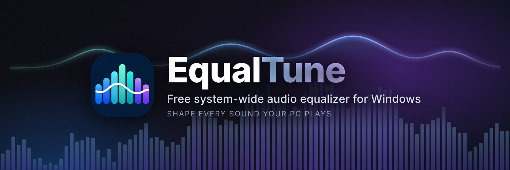
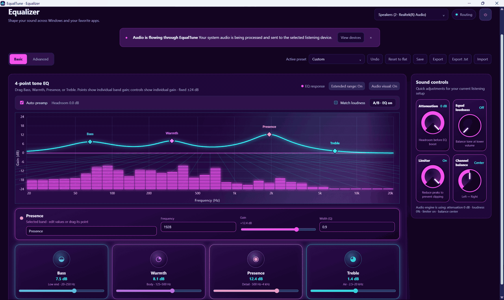
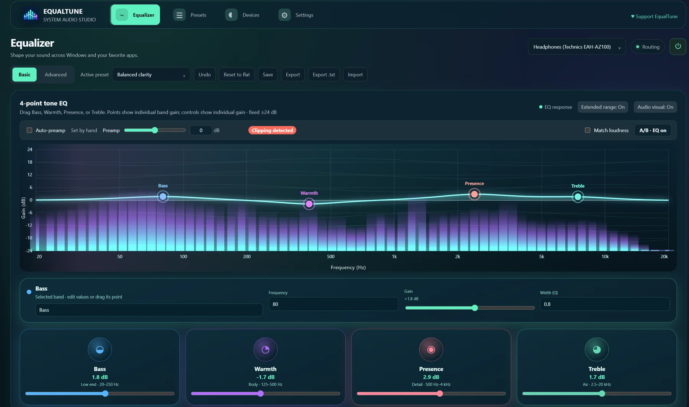
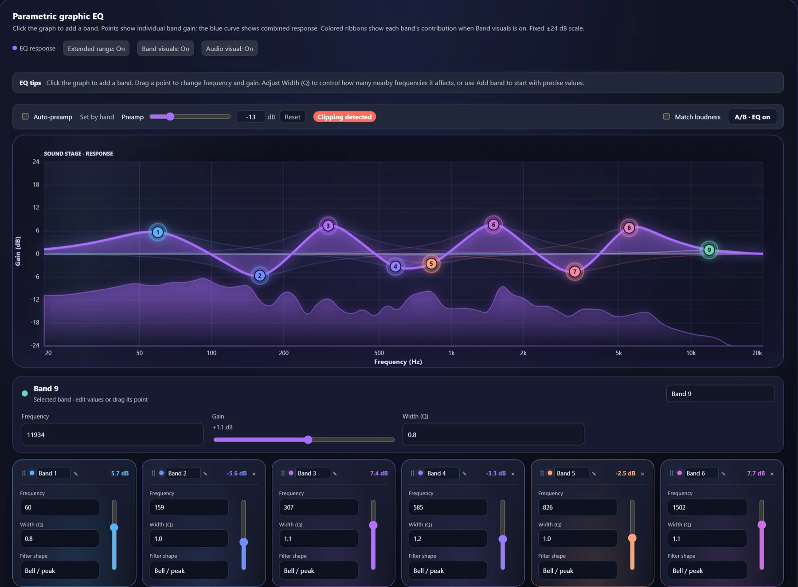
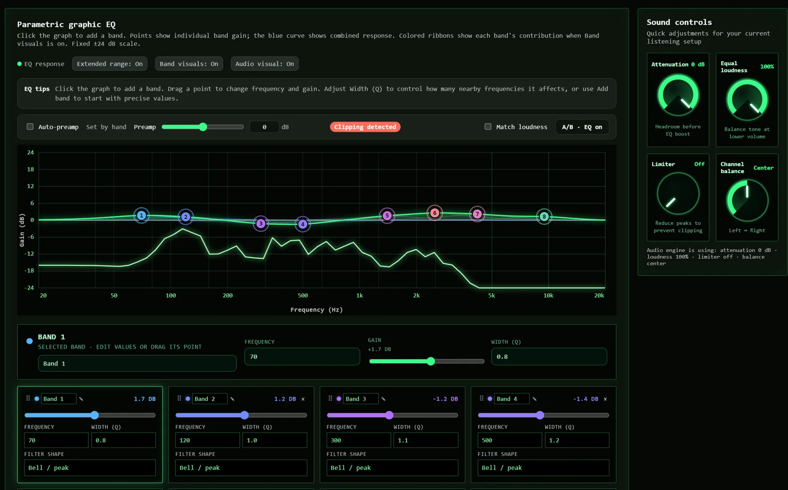
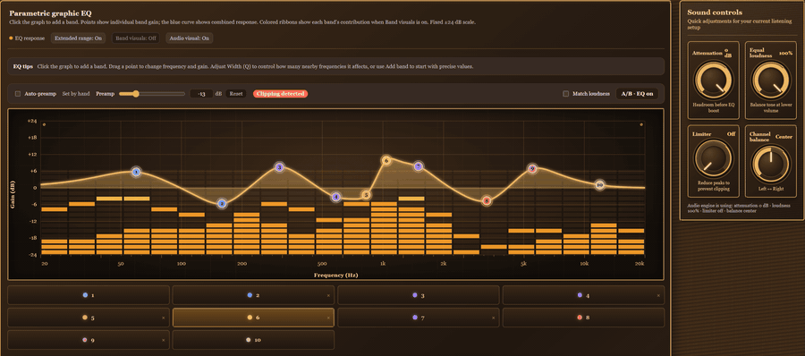
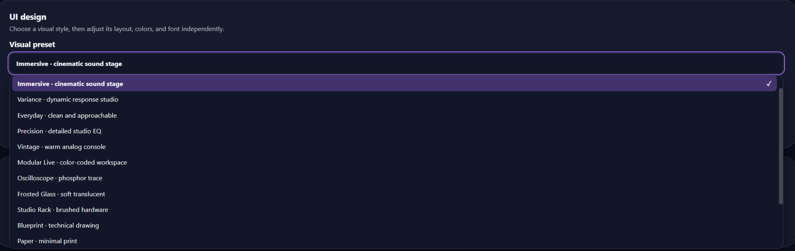
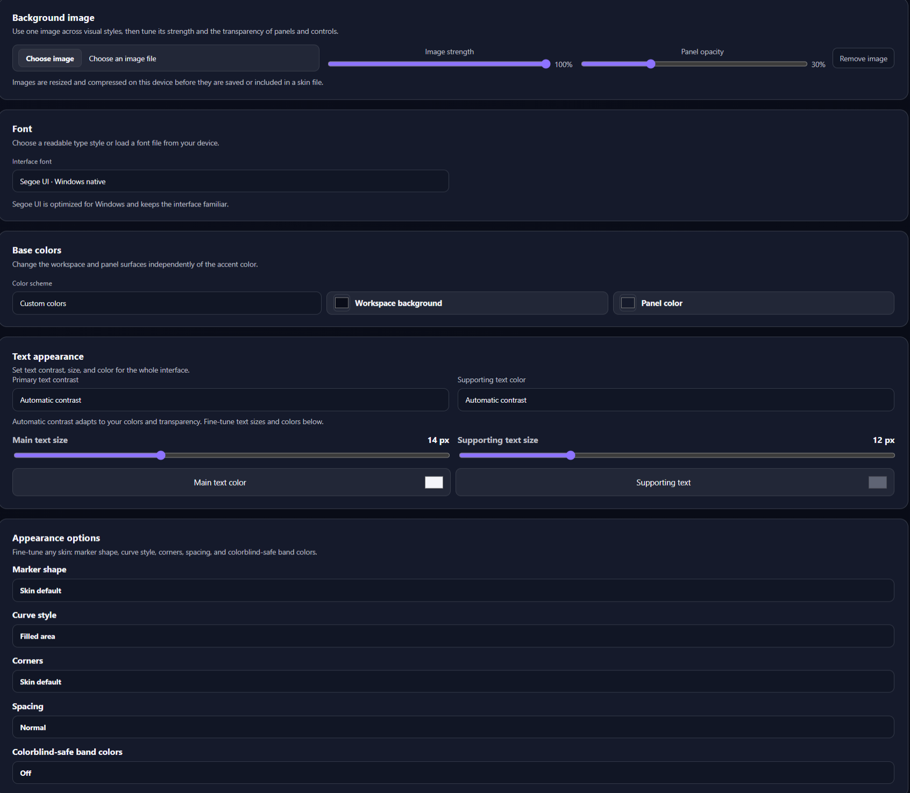

# EqualTune



EqualTune is a free, system-wide audio equalizer for Windows. A WPF window hosts the HTML interface in WebView2, and a native WASAPI engine does the audio work.

[](https://github.com/SpacemanLF/EqualTune/releases/latest)
[](https://buymeacoffee.com/equaltune)
[](https://www.reddit.com/r/EqualTune/)

## Download

1. Go to the [**latest release**](https://github.com/SpacemanLF/EqualTune/releases/latest).
2. Download `EqualTune-Setup-x.y.z.exe` under **Assets** and run it.
3. Follow the setup. It can install VB-CABLE for you if you don't have it yet.

EqualTune is for Windows 10 and 11 (64-bit) for now.   **A Linux version is in development** (see [Roadmap](#roadmap)).

Windows may show a "Windows protected your PC" warning because the installer is not code-signed yet: click **More info → Run anyway**.

## Screenshots



**Basic mode:** four tone controls (Bass, Warmth, Presence, Treble) with a live spectrum behind the curve.



**Advanced mode:** up to 12 parametric bands, each with its own frequency, gain, width (Q) and filter shape, plus a manual preamp with Reset and a clipping warning.



| | |
| --- | --- |
| <br>Every band can be named, dragged, reordered and given its own filter shape. | <br>A live spectrum behind the curve, with 14 built-in presets and 100 more in the optional preset packs. |
| <br>16 visual styles to choose from. | <br>Background image, fonts, colors and text sizes. |


## What it does

- **Equalizer:** up to 12 live bands (bell, shelves, high/low-pass, notch and more) with frequency, gain and Q, drawn on a live response graph. Basic mode uses four tone bands; Advanced adds and removes bands.
- **System-wide routing:** apps play into the VB-CABLE virtual device, EqualTune applies the EQ and plays the result on your headphones or speakers. Switching the listening output while routing keeps the route running.
- **Volume:** the Windows volume slider (and mute) controls the routed sound. `Ctrl+Alt+↑ / ↓` change the Windows volume in 5% steps.
- **Presets:** 14 built-in presets (4- and 8-band versions), your own saved presets, and a Presets page to rename, delete, import and export them. Equalizer APO / AutoEq text files can be imported and exported, and you can import GraphicEQ files and frequency/gain tables (CSV or text) too: curves are matched with EqualTune's 12 bands.
- **Preset packs:** optional downloads from [equaltune.app](https://equaltune.app) with 100 ready-made presets: 37 headphones, 33 earphones and 30 genres. Headphone and earphone presets are based on [AutoEq](https://github.com/jaakkopasanen/AutoEq) results. Import them from the Presets page.
- **Device changes:** if your headphones disconnect or reconnect while routing, EqualTune recovers on its own.
- **Per-output and per-app EQ:** each output device remembers its own EQ, and EqualTune can switch presets automatically for the app you are using.
- **Sound tools:** auto-preamp with a clip warning, a manual preamp slider (saved with presets and set by the `Preamp:` line when you import an Equalizer APO or AutoEq file), level-matched A/B compare, limiter, channel balance, equal loudness and attenuation.
- **Live spectrum**, a different visual style for each of 16 skins, custom skins, background images and fonts.
- **Global hotkeys:** `Ctrl+Alt+E` EQ on/off · `Ctrl+Alt+B` A/B compare · `Ctrl+Alt+←/→` previous/next preset · `Ctrl+Alt+↑/↓` volume.
- **Safe output restore:** if EqualTune stops or crashes, Windows sound is switched back to your real output.

## Make it yours

EqualTune is built to be customized, and everything you make can be saved and shared.

**Presets**
- Start from one of the 14 built-in presets, or build your own by dragging points on the graph or typing exact frequency, gain and Q values.
- Click **Save** to keep your EQ as a named preset. **Save a copy** on any built-in preset lets you tweak it without losing the original.
- **Export** writes an `.equaltune-eq.json` file you can send to a friend. **Import** loads one back in.
- **Export .txt** writes the Equalizer APO / AutoEq text format, so you can take your EQ to other EQ apps.
- **Import** reads your own `.equaltune-eq.json` files and the common formats people share for headphones: Equalizer APO / AutoEq filter lines, Room EQ Wizard (REW) filter settings, AutoEq GraphicEQ files, and frequency/gain tables saved as CSV or text (for example AutoEq's result CSVs or a REW measurement exported as text). REW's `.mdat` project files can't be read: export the filter settings or the measurement as text instead. A curve is matched with EqualTune's 12 bands (an approximation, and EqualTune tells you how close the match is), and EqualTune switches to Advanced mode so you can see every band.

**Skins and layouts**
- Pick one of 16 visual styles (studio, cinematic, vintage analog, oscilloscope, frosted glass, blueprint, paper, synthwave, game HUD, aurora, high contrast and more), then adjust it:
  - accent color (presets or any custom color), text color, contrast and text sizes
  - marker shape, curve style, corner roundness and spacing
  - colorblind-safe band colors
- Save your setup as a **custom skin**, then use **Export skin file** to share it as an `.equaltune-skin.json` file. Anyone can load it with **Import skin file**. Background images are included in the file.

**Custom backgrounds**
- Upload your own background image (PNG, JPEG or WebP) from your computer, and adjust its opacity until the interface stays easy to read.
- Images are resized and compressed on your computer before they're saved, so large photos are fine.
- Remove it at any time to go back to the skin's own look.
- A background is saved as part of your custom skin, so when you export a skin file the image goes with it.

**Fonts**
- Choose a built-in interface font (Segoe UI, Arial, Verdana, Tahoma, Trebuchet MS, Georgia, Times New Roman or Consolas), or pick **Custom font** and upload your own `.woff2`, `.woff`, `.ttf` or `.otf` file.
- Skin files do not include uploaded fonts, because font licenses often don't allow redistribution. If you share a skin that uses a custom font, send the font file separately when its license permits.

All of this stays on your computer, in your own settings.

## Roadmap

- **Linux version:** in development. A working port (Ubuntu with GNOME, using PulseAudio/PipeWire) is in this repository under `shell/` and `core/`, and uses the same interface as Windows. There's no installer or package yet; one is planned. Notes are in [LINUX-PORT.md](LINUX-PORT.md).

## Community

Questions, bug reports, shared presets and skins: join **[r/EqualTune](https://www.reddit.com/r/EqualTune/)** on Reddit. You can also [open an issue](https://github.com/SpacemanLF/EqualTune/issues) here on GitHub.

## Where things are kept

| What | Where |
| --- | --- |
| Settings, presets, skins, app rules | `%LOCALAPPDATA%\EqualTune\WebView2` |
| Output-restore state | `%LOCALAPPDATA%\EqualTune\output-guard.json` |
| Log files | `logs` folder next to the app (falls back to `%LOCALAPPDATA%\EqualTune\logs` if that folder is read-only); the last 14 days are kept |

Only one copy of EqualTune runs at a time: starting it again brings the open window to the front.

## VB-CABLE

System-wide routing needs VB-CABLE, a donationware virtual audio device by [VB-Audio Software](https://vb-audio.com/Cable/). EqualTune does not include or replace it. Donating to VB-Audio is optional and goes to them. Settings → About has a link to their page.

## Supporting EqualTune

EqualTune is free to use. Settings → About and the sidebar have an optional **Support EqualTune** button that opens https://buymeacoffee.com/equaltune (set in `AppInfo.DonateUrl`).

## Install and update

Download `EqualTune-Setup-x.y.z.exe` from the [Releases](https://github.com/SpacemanLF/EqualTune/releases) page and run it. You can choose the install folder. Setup installs the .NET Desktop Runtime and WebView2 only when they are missing, and can install VB-CABLE for you.

EqualTune checks GitHub for new versions about once a day (Settings → About; this can be turned off) and updates only after you approve. Windows may show a SmartScreen warning because the installer is not code-signed yet: choose **More info → Run anyway**.

To build the installer yourself, see [RELEASING.md](RELEASING.md).

## Build and run

Requires the .NET 10 SDK and the Windows Desktop Runtime.

```powershell
dotnet build -c Release
dotnet run --project .\EqualTune.AudioLab.csproj
```

The audio engine uses Windows' built-in Core Audio COM and WASAPI APIs directly. The only package dependency is Microsoft's WebView2 SDK.

The app icon is `Assets/EqualTune.ico` (source: `Assets/EqualTune-icon-1024.png`). The same icon is used for the window, the EXE and the installer.
## Notes

- The routed sound uses the shared-mode mix format; 32-bit float and 16-bit PCM are supported.
- Playback loopback (capturing a normal output instead of the virtual cable) is a diagnostic preview: the original sound keeps playing alongside the processed copy.

>
  
</a>
